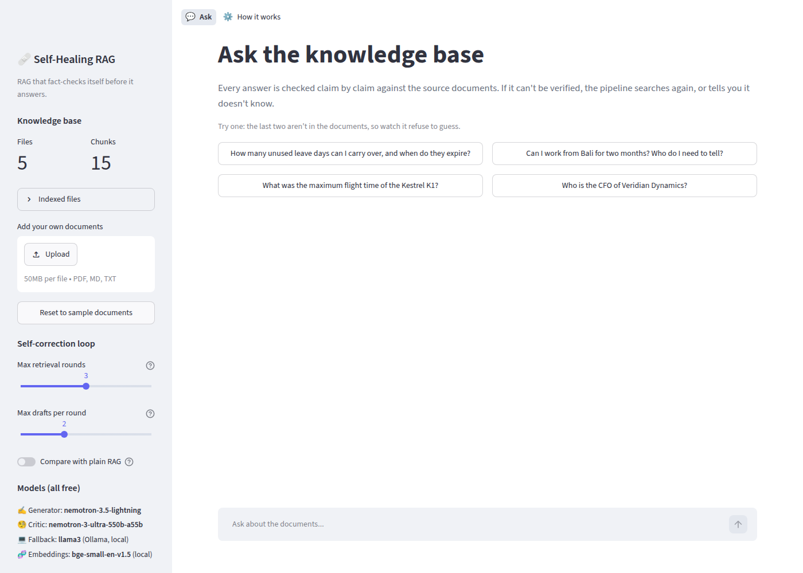
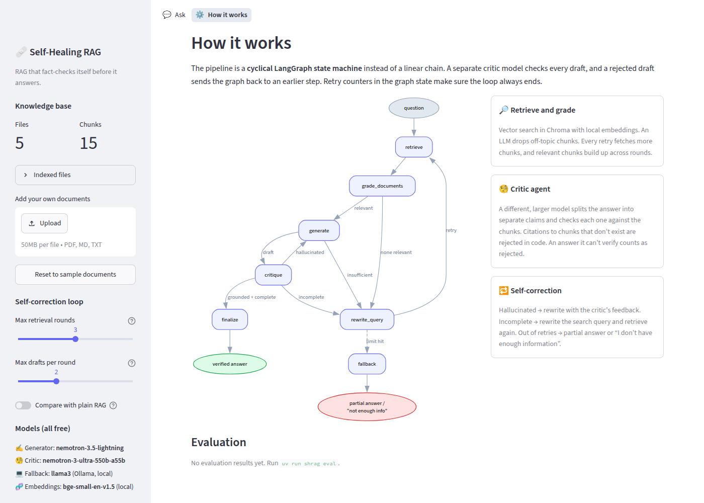
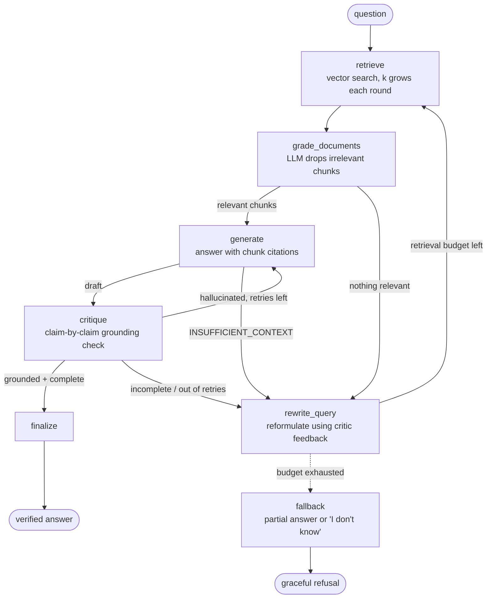

# Self-Healing RAG

A Retrieval-Augmented Generation pipeline that **checks its own answers and retries** instead of just retrieving and generating. A separate critic model checks every claim in a draft against the retrieved chunks. Rejected drafts are rewritten; if the documents don't contain the answer, the query is reformulated and the search runs again. When the retry budget runs out, the pipeline says *"I don't have enough information"* instead of making something up.

The whole workflow is a **stateful, cyclical LangGraph state machine** with hard retry limits, not a linear chain.

Runs entirely on **free models**: OpenRouter `:free` LLMs, falling back to local Ollama, plus local CPU embeddings.



## Web app

```bash
uv run streamlit run app.py
```

- **Chat** with the knowledge base. Each step of the graph (retrieve → grade → generate → critique → retry) appears live while it runs.
- Every answer has a badge (**Verified**, **Partial**, or **Not enough information**) and three tabs:
  - **Trace:** every step, including rejected drafts.
  - **Critic report:** each claim marked ✅ supported or ❌ unsupported, with the chunk that backs it.
  - **Sources:** the exact chunks behind the answer, with similarity scores.
- **Compare with plain RAG** shows a normal one-shot RAG answer next to it, so you can see the difference.
- **Upload your own** PDF / Markdown / text files from the sidebar and ask about them. Retry limits are adjustable with sliders.
- **How it works** page: the graph diagram plus the latest evaluation results.



## How it works



| Node | What it does |
|---|---|
| `retrieve` | Searches Chroma for the current query. Each retry fetches more chunks (`k = 4, 6, 8…`). |
| `grade_documents` | An LLM keeps only the chunks relevant to the question. Relevant chunks **build up across rounds**, so a question that needs two documents can be answered from pieces found by different queries. |
| `generate` | Answers only from the numbered chunks, with citations like `[2]`. It returns `INSUFFICIENT_CONTEXT` when the chunks don't answer the question. On a retry it gets the critic's feedback. |
| `critique` | **The critic agent.** A *different*, larger model splits the answer into separate claims and marks each one supported or unsupported by the context. A code check also rejects citations to chunks that don't exist. If the critic's reply can't be read, the answer counts as **rejected**, never accepted. |
| `rewrite_query` | Writes a new search query from the original question, the queries already tried, and why the last attempt failed (no relevant chunks, missing information, or hallucination). |
| `fallback` | Runs when the retry limits are hit. It returns the best answer that passed the grounding check (marked incomplete), or a clear *"I don't have enough information"*. |

### Critic verdicts → routing

| Critic finding | Verdict | Next step |
|---|---|---|
| Every claim is supported and the question is fully answered | `accept` | `finalize` |
| Unsupported claims or bad citations | `regenerate` | `generate` again with feedback (up to `MAX_GENERATIONS` per round) |
| Grounded, but part of the question is unanswered | `re_retrieve` | `rewrite_query` → `retrieve` (up to `MAX_RETRIEVALS` rounds) |

### Why the loop always ends

- `retrieval_attempts` and `generation_attempts` live in the graph state. Routing functions check them against `MAX_RETRIEVALS` (default 3) and `MAX_GENERATIONS` (default 2, reset each round).
- As a backstop, LangGraph's `recursion_limit` is set to the largest number of steps those limits allow, so a routing bug would raise an error rather than loop forever.
- Tests cover the worst case: a critic that rejects everything (`tests/test_graph.py::test_retry_limits_stop_endless_rejection`).

## Free model stack

| Part | Default | Cost |
|---|---|---|
| Generator / grader / rewriter | `nvidia/nemotron-3.5-lightning:free` → `google/gemma-4-31b-it:free` → `nvidia/nemotron-3-ultra-550b-a55b:free` | Free (OpenRouter) |
| Critic | `nvidia/nemotron-3-ultra-550b-a55b:free` first (a different, larger model than the generator, so it isn't grading its own work) | Free (OpenRouter) |
| Last-resort fallback | `llama3` via local Ollama | Free (your machine) |
| Embeddings | `BAAI/bge-small-en-v1.5` via FastEmbed (ONNX, CPU) | Free (local) |
| Vector store | Chroma, saved to `.chroma/` | Free (local) |

Free models are often rate-limited or temporarily down, so each role uses a LangChain `with_fallbacks` chain: if one model fails, the next one answers. Free models also don't reliably support tool calling, so structured outputs (relevance grades, critiques) are requested as JSON in the prompt and checked with Pydantic, with one retry if the JSON doesn't parse.

> **Free-tier limit:** OpenRouter allows 50 free-model requests per day on an account with no credits (1,000/day once $10 of credit has ever been added). One question takes about 3–8 requests. Once the daily limit is used up, the pipeline switches to local Ollama automatically. It keeps working, just slower on a CPU-only machine.

## Quick start

```bash
# 1. Install (needs uv: https://docs.astral.sh/uv/)
uv sync

# 2. Add your free OpenRouter key (or skip it and just run Ollama: `ollama pull llama3`)
cp .env.example .env   # then edit OPENROUTER_API_KEY

# 3. Index the sample knowledge base (or any folder of .md / .txt / .pdf files)
uv run shrag ingest                 # defaults to data/docs
uv run shrag ingest ~/my-papers     # your own documents

# 4. Ask questions
uv run shrag ask "How many unused leave days can I carry over?"
uv run shrag ask "Who is the CFO?" --baseline   # compare with plain RAG
uv run shrag chat                                # interactive

# 5. Web UI with a live step-by-step trace
uv run streamlit run app.py
```

Example trace for a question the documents can't answer:

```
● retrieve         Round 1: fetched 4 chunks for 'Who is the CFO of Veridian Dynamics?'
● grade_documents  0/4 new chunks relevant; 0 in context
● rewrite_query    New query: 'Veridian Dynamics Chief Financial Officer'
● retrieve         Round 2: fetched 6 chunks for 'Veridian Dynamics Chief Financial Officer'
● grade_documents  0/6 new chunks relevant; 0 in context
● rewrite_query    New query: 'Veridian Dynamics finance director'
● retrieve         Round 3: fetched 8 chunks for 'Veridian Dynamics finance director'
● grade_documents  0/8 new chunks relevant; 0 in context
● fallback         Retry limit reached; declined to answer
╭─────────────────────────── INSUFFICIENT ───────────────────────────╮
│ I don't have enough information in the knowledge base to answer    │
│ that confidently. I searched for: 'Who is the CFO of ...', ...     │
╰────────────────────────────────────────────────────────────────────╯
```

## Sample knowledge base

`data/docs/` describes **Veridian Dynamics**, a made-up drone company (handbook, product spec, warranty policy, engineering practices, FAQ). Because it's fictional, a model can't answer from its training data, so any detail that isn't in the documents is clearly a hallucination. That makes the critic's work easy to see.

## Evaluation

`uv run shrag eval` runs `eval/questions.json` through both plain RAG and the self-healing pipeline. The set has 8 answerable questions, some of which use different wording from the documents ("Estonia" vs "Tallinn", "work from Bali" vs "remote work outside home country"), and 6 unanswerable questions written to tempt a model into guessing (the discontinued K1's flight time, the CFO, revenue, …).

_Results are added after the evaluation run finishes._

Scoring is deliberately simple: an answerable question is correct if every expected fact appears in the answer, and an unanswerable one is correct if the system declines. Full answers are saved to `eval/results/`. Free models vary from run to run, so expect some variation.

## Project layout

```
src/shrag/
  graph.py        LangGraph wiring: nodes, conditional edges, the retry cycle
  nodes.py        node logic, critic verdicts, routing functions, loop limits
  state.py        typed graph state (with reducers for trace / counters)
  prompts.py      grader, generator, critic, rewriter and baseline prompts
  structured.py   JSON extraction + Pydantic schemas for free-model outputs
  llm.py          OpenRouter free models with fallbacks, Ollama last resort
  vectorstore.py  loading (.md/.txt/.pdf), chunking, local embeddings, Chroma
  pipeline.py     SelfHealingRAG: ask(), stream(), baseline()
  cli.py          shrag ingest | ask | chat | graph | eval
app.py            Streamlit web app (chat, live trace, critic report, uploads)
tests/            offline tests of every loop path, using scripted fake LLMs
eval/             evaluation questions (results are written to eval/results/)
```

## Tests

```bash
uv run pytest
```

The tests swap the LLMs for LangChain's `FakeListChatModel` and use an in-memory retriever, so they run offline in about a second. They cover: accept on the first try, regenerating a hallucinated answer, rewriting the query when nothing relevant is found, endless rejection stopped by the limits, a partial answer after re-retrieval, the generator reporting insufficient context, a critic reply that can't be read, and citations to chunks that don't exist.

## Configuration

All settings are environment variables (see `.env.example`): model lists, `MAX_RETRIEVALS`, `MAX_GENERATIONS`, `BASE_K`, `K_STEP`, `CHUNK_SIZE`, `CHUNK_OVERLAP`, `EMBEDDING_MODEL`, `CHROMA_DIR`.
